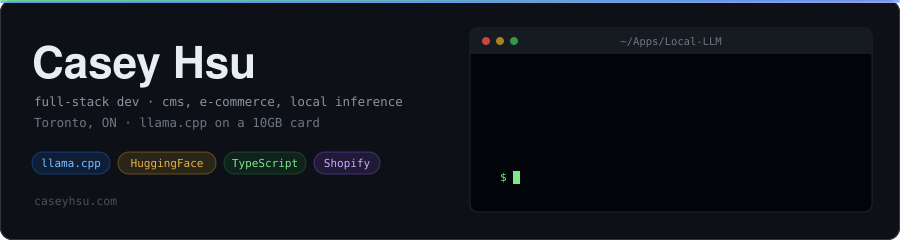
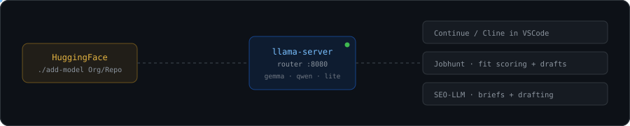

<p align="center">
  <a href="https://caseyhsu.com">caseyhsu.com</a> ·
  <a href="https://linkedin.com/in/casey-hsu">linkedin</a> ·
  <a href="https://caseyhsu.com/resume.pdf">résumé</a> ·
  <a href="mailto:casey-hsu@outlook.com">email</a>
</p>

```console
$ cat ~/.plan
CMS and e-commerce by day: Shopify, HubSpot, WordPress, Contentful.
Local inference by night: llama.cpp, GGUF quants, and an eval suite
that picks which model gets which job so I don't have to guess.
```

I build the client work and the tooling I use to do it. Most spare cycles go into a
three-model local stack on one 10 GB card. No fine-tuning: just prompts, quants, and
measurements.

---

## The lab



`./add-model Org/Repo-GGUF` queries the HuggingFace API, lists every GGUF in the repo with
its quant and size, and writes the download plus a builder preset. `make build` generates
each model's system prompt, `make serve` brings up the router with one slot per model and a
10 minute idle sleep that drops a loaded model from 6226 MiB of VRAM to 242.



Measured by `eval/run-speed.py` on a fixed prompt set, same sampler across all three.
Generation speed is the boring half. Prompt ingest is what you actually feel:

```
prompt tok/s     lite 2796  ·  gemma 701  ·  qwen 430
```

Agentic tools re-read a ~3k token system prompt every turn, so the dense 9B that fits
entirely in VRAM beats both MoE models for tool use despite being the smallest.

```
gemma   gemma4-26b-a4b-it-qat     64K ctx   22 MoE layers on CPU
qwen    qwen3.6-35b-a3b-mtp       64K ctx   35 MoE layers on CPU, MTP
lite    qwen3.5-9b-mtp Q4_K_M     64K ctx   all GPU, speed anchor + 3rd judge
```

Three models rather than two for a measurement reason: the learn and tutor suites grade
with a leave-one-out judge panel, so two models left exactly one judge per response and
inter-judge disagreement could never be computed.

> Moved off Ollama to llama.cpp on 2026-09-14. `gemma` and `qwen` are the same weights,
> copied out of Ollama's blob store, so their benchmark history carries over. `lite` starts
> fresh: Ollama's `qwen3.5:9b` won't load in llama.cpp, so it's unsloth's MTP build now.

## Building

**[Local-LLM](https://github.com/SimBuds/Local-LLM)** · the stack above. Layered Markdown
compiled into system prompts and per-model router presets, plus evals for speed, coding,
content, tool calling, and tutoring. Nothing is baked into the weights, so every behavior
change is version-controlled and reversible.
`llama.cpp` `GGUF` `HuggingFace` `Python`

**[Jobhunt](https://github.com/SimBuds/Jobhunt)** · local-first job-search CLI. Six stages
over one SQLite database, nine ATS integrations plus RSS over async HTTP. One gateway is the
only place the model is reached, every call schema-bounded, and the audit path has no LLM in
it at all. The tool fills the application form and never clicks Submit. 1,200+ tests, ruff,
strict mypy.
`Python` `asyncio` `SQLite` `llama-server` `Playwright`

**[Everything4Cats](https://everything4cats.ca)** · WordPress affiliate site I own end to
end, launching Nov 2026. One idempotent script turns a bare Ubuntu Lightsail host into a working site; a custom
theme and two plugins carry the post types and the affiliate-disclosure layer. Docker is the
test harness, not the target: it runs the provisioner twice, because once proves it works
and twice proves it is idempotent.
`WordPress` `PHP` `AWS Lightsail` `Docker` `Bash` `WP-CLI`

**[SEO-LLM](https://github.com/SimBuds/SEO-LLM)** · no standalone app. Claude Code is the
runtime and the llama.cpp router is the model server: skills replace the CLI, Bash replaces
the workflow engine, files replace the database. Long articles are drafted section by
section with a separate rewrite pass, and anything decidable by arithmetic lives in a
deterministic check script rather than a second model call.
`Claude Code` `llama.cpp` `Bash` `JSON Schema`

## Shipped

Developer since 2022: part-time at Atelier Dacko, plus contract work for Neurative AI and
Geeked Out Goods.

**Atelier Dacko** `2023-now` · WordPress to Shopify migration for a jewelry brand, holding
indexed URLs. The store launched in 2026 as a Shopify and WordPress hybrid on one domain via
a Cloudflare Worker, on a customized Dawn theme. Google search impressions grew 78% in six
months, and a local LLM content pipeline cut drafting from 30 minutes to 5 across 200+
products.
`+78% search impressions` `-80% drafting time`

**Neurative AI** `2026` · Marketplace-standard HubSpot theme with 22 reusable HubL modules,
built from the in-house team's Figma designs. WCAG 2.1 AA, with HubSpot CRM integration.
`22 modules` `WCAG 2.1 AA`

**Geeked Out Goods** `2022-2023` · Python ingest for a 400+ item Shopify catalog, schema-checking
CSV exports so malformed feeds never reached the live store.
`400+ items` `validated at ingest`

## Stack

```
core        TypeScript · React · Python · PHP/Sass
cms         Shopify (Liquid) · HubSpot (HubL) · WordPress · Contentful
local ai    llama.cpp · GGUF/quants · HuggingFace · MCP · Claude Code
seo         technical SEO · JSON-LD · Search Console · GA4
data        SQLite
devops      Docker · GitHub Actions · Playwright · AWS · nginx
coursework  Java · Angular · MongoDB
```

<sub>Contentful Certified Professional, with the Personalization Skill Badge · George Brown Polytechnic, Computer Programming &amp; Analysis (Dean's List, all terms) · ten years as a sous chef, until Nov 2024 alongside the diploma and part-time dev work, which is where the deadline tolerance comes from.</sub>
